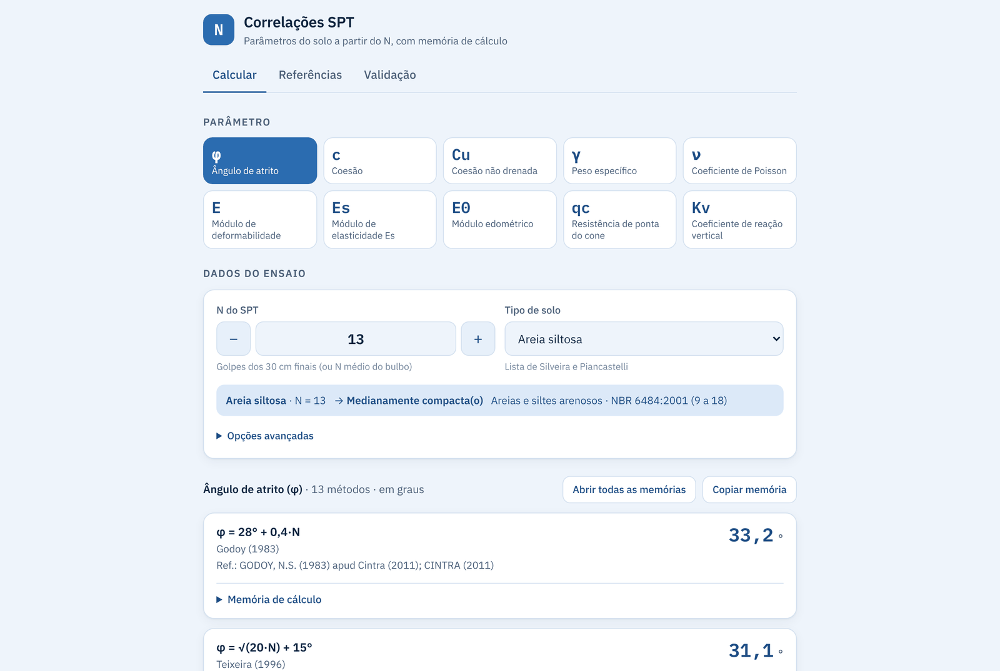
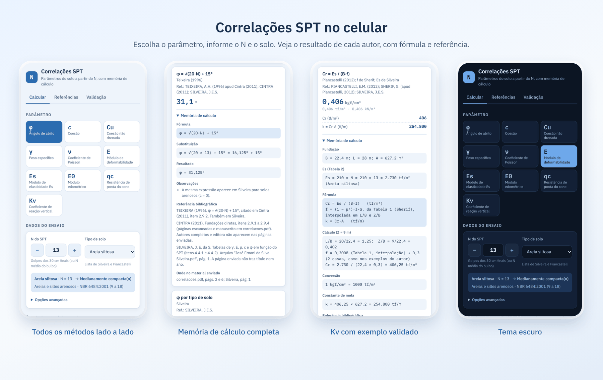
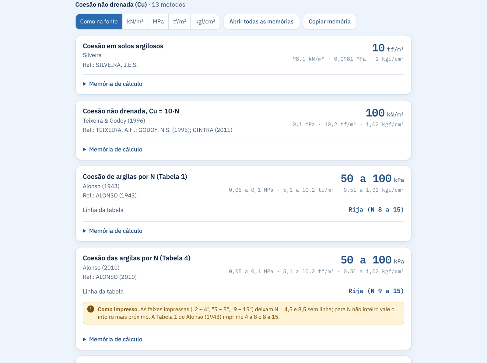
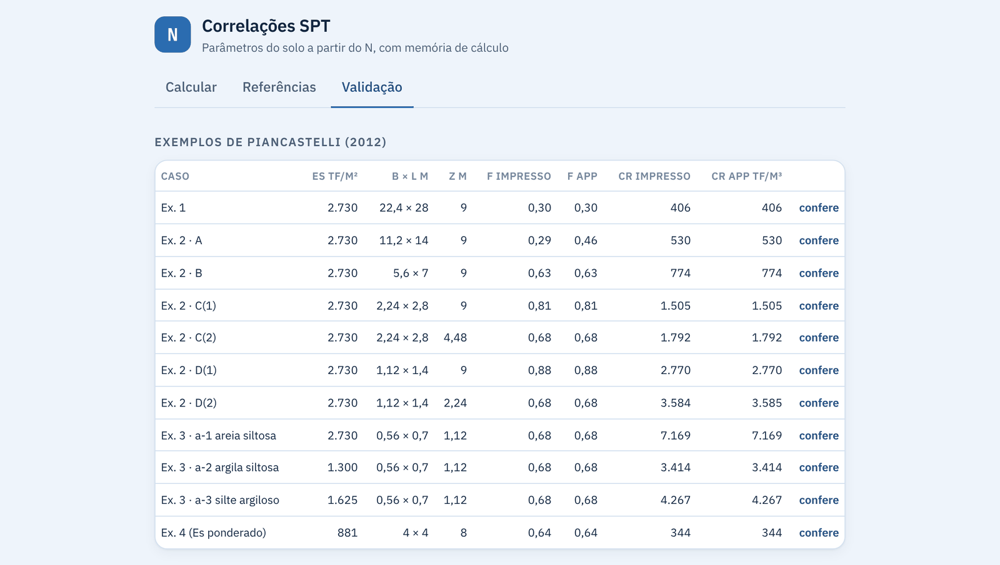

# Correlações SPT

App de engenharia geotécnica que calcula **φ, c, Cu, γ, ν, E, Es, E0, qc e Kv** a partir do **N do SPT** e do tipo de solo. Mostra o resultado de **cada autor lado a lado**, com **fórmula, substituição numérica e referência bibliográfica**. Nenhuma fórmula ou valor tabelado é alterado ou harmonizado entre métodos.

É um PWA: abre no navegador do computador ou do celular, pode ser instalado e funciona offline.



## O que o app faz

- **10 parâmetros** a partir do N e do solo: ângulo de atrito, coesão, coesão não drenada, peso específico, Poisson, E, Es, E0, resistência de ponta do cone e coeficiente de reação vertical.
- **Mais de 75 métodos** de dezenas de autores e normas (Godoy, Teixeira & Godoy, Silveira, Piancastelli, Schmertmann, Alonso, Bowles, Clayton, Kulhawy & Mayne, Hatanaka & Uchida, Joppert, NBR 6122 e outros). Cada um mostra o valor da sua própria fonte, e valores diferentes entre autores são esperados.
- **Memória de cálculo completa** em cada método: fórmula, substituição, resultado, avisos, observações e referência.
- **Avisos claros**: faixa de validade, premissas assumidas e valores impressos que merecem conferência aparecem no próprio cartão.
- **Classificação pela NBR 6484:2001** (compacidade e consistência), com os limites de N à vista.
- **Unidades à escolha**: kN/m², MPa, tf/m², kgf/cm², kgf/cm³ e outras, sem perder a unidade da fonte.
- **Copiar memória** do parâmetro inteiro, pronta para colar em um relatório.
- **Uso no celular e offline**, com tema claro e escuro.



## Resultados lado a lado

Cada cartão traz o autor, a referência e o resultado. Tabelas por faixa de N mostram a linha encontrada; quando N está num limite entre duas faixas, as duas aparecem.



## Validado com exemplos publicados

O cálculo de Kv de Piancastelli (2012) é conferido contra os exemplos 1 a 4 do próprio autor. O app mostra o valor impresso e o valor calculado lado a lado, e também aponta onde o material impresso tem divergência.



## Arquivos
- `index.html`, `styles.css`, `app.js`: interface.
- `engine.js`: todas as correlações e tabelas (sem dependências).
- `manifest.webmanifest`, `sw.js`, `icons/`: instalação e uso offline (PWA).
- `tests/validate.js`: conferência com os exemplos de Piancastelli (2012) e checagens independentes. Rodar com `npm test` (ou `node tests/validate.js`).
- `build-preview.js`: gera `dist/preview.html`, uma versão em página única (`npm run build:preview`).
- `docs/REGRAS.md`: regras do projeto e como adicionar uma correlação.
- `CHANGELOG.md`: histórico de versões.
- `.github/workflows/pages.yml`: roda os testes e publica no GitHub Pages a cada push na `main`.

## Publicar (GitHub Pages)
1. No repositório: **Settings → Pages → Build and deployment → Source: GitHub Actions** (uma vez só).
2. A cada `git push` na `main`, o workflow roda os testes e publica o site. O endereço aparece em Settings → Pages e em Actions.
3. A versão do cache do service worker é trocada automaticamente pelo commit publicado, então os aparelhos baixam a versão nova sozinhos.

Para outro hospedeiro (Netlify Drop, Cloudflare Pages), basta enviar `index.html`, `styles.css`, `app.js`, `engine.js`, `sw.js`, `manifest.webmanifest` e a pasta `icons/`. Nesse caso aumente o número em `const CACHE = 'spt-correlacoes-vN'` no `sw.js` a cada versão.

## Instalar no celular
- Android (Chrome): menu ⋮ → "Instalar app".
- iPhone (Safari): Compartilhar → "Adicionar à Tela de Início".

## Fluxo de atualização
```
git pull
# editar engine.js / app.js ...
npm test
git add -A
git commit -m "feat: descrição da mudança"
git push
```
Registre a mudança em `CHANGELOG.md`.

## Fontes
Os PDFs de origem e as páginas onde cada valor aparece estão listados na aba "Referências" do app e na memória de cada cálculo. Os PDFs não fazem parte do repositório.
